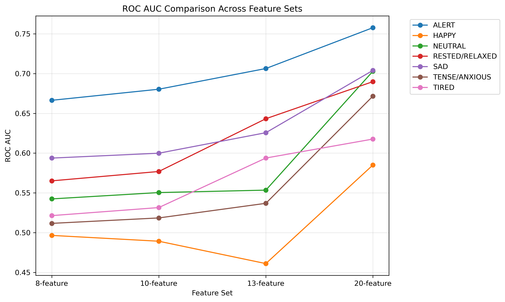
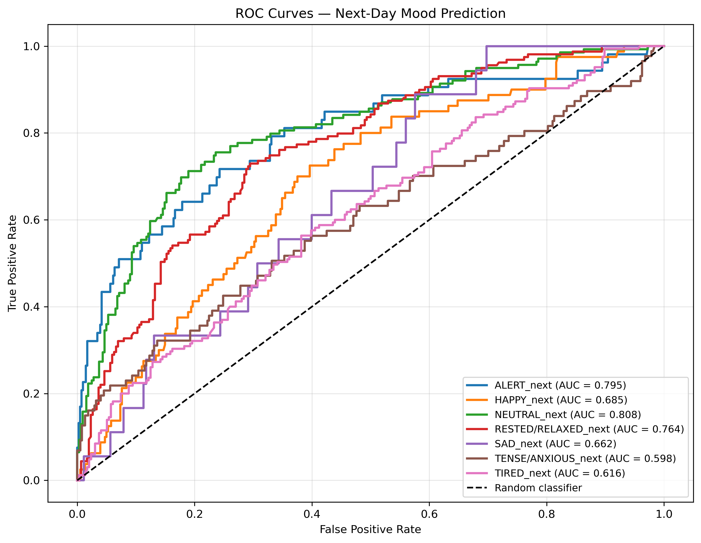

# Fall 2026 — Next-Day Mood Prediction with LifeSnaps

An Erdős Institute Data Science Boot Camp project investigating whether wearable-device measurements, participant demographics, and current-day self-reported moods can predict **mood labels on the following day**.

## Team members
- Amal Sebastian
- Ryan Zhang
- Sam Johnson


## Project overview

We develop and evaluate machine-learning models to predict seven next-day mood labels: **ALERT, HAPPY, NEUTRAL, RESTED/RELAXED, SAD, TENSE/ANXIOUS, and TIRED**. Because multiple moods can be reported on the same day, we model the task as **seven independent binary classification problems** rather than a single multiclass problem.

The final approach uses 20 features and a tuned Random Forest classifier for each mood. We assess both probability estimates and threshold-based predictions on a held-out, participant-wise chronological test set.

## Motivation and problem statement

Wearables provide continuous measurements of activity, heart rate, and sleep, but it is less clear how much these signals help predict self-reported mood on the next day. We ask:

> **Can we predict the probability of each next-day mood using today's wearable measurements, demographic characteristics, and self-reported mood? How much does current-day mood contribute relative to the other features?**

## Potential stakeholders

Potential audiences include researchers studying behavioral patterns and digital well-being, and developers exploring personalized wellness applications. The results are exploratory and **must not be interpreted as clinical diagnoses or mental-health screening tools**.

## Dataset

We use the public **LifeSnaps** dataset, which combines Fitbit Sense measurements with surveys and ecological momentary assessments. The source study includes 71 participants. See the [dataset publication](https://doi.org/10.1038/s41597-022-01764-x) and [Zenodo dataset record](https://zenodo.org/records/7229547).

In our processed daily analysis table:

| Dataset stage | Observations | Participants |
|---|---:|---:|
| Merged daily records | 7,410 | 71 |
| Records with a usable next-day mood target | 2,276 | 63 |
| Development set | 1,815 | 63 |
| Held-out test set | 461 | 49 |

The processed date range is April 2021–January 2022. Targets are constructed by matching each participant's day *t* to their mood labels on calendar day *t + 1*; records without usable next-day targets are excluded.

### Predictors (20 features)

- **10 wearable / physiological features:** `steps`, `calories`, `sedentary_minutes`, `lightly_active_minutes`, `moderately_active_minutes`, `very_active_minutes`, `bpm`, `sleep_hours`, `resting_hr`, and `sleep_efficiency`.
- **3 demographic features:** `age`, `gender`, and `bmi_group`.
- **7 current-day mood features:** `ALERT`, `HAPPY`, `NEUTRAL`, `RESTED/RELAXED`, `SAD`, `TENSE/ANXIOUS`, and `TIRED`.

Numerical features are median-imputed and scaled; demographics are one-hot encoded. Missing current-day mood reports are represented as a separate category rather than as an absent mood. Preprocessing is fitted on training data only.

## Modeling approach

We formulated this project as seven independent binary classification problems, each corresponding to a different next-day mood: ALERT, HAPPY, NEUTRAL, RESTED/RELAXED, SAD, TENSE/ANXIOUS, and TIRED. Each classifier independently predicts the probability of experiencing its corresponding mood on the following day.

1. **Target construction and exploration:** Targets are constructed by matching each participant's day *t* to their mood labels on calendar day *t + 1*; records without usable next-day targets are excluded.
2. **Chronological evaluation:**  We split the data chronologically for each participant, using the earlier 80% of observations for training and the remaining 20% for testing. Within the training set, we used three expanding-window chronological validation folds to evaluate model performance. Since 49 participants appear in both the training and test sets, our evaluation measures how well the models predict future moods for previously observed participants, rather than for entirely new individuals.
3. **Feature comparisons:** Compare progressively richer sets of 8, 10, 13, and 20 predictors using Logistic Regression.
4. **Algorithm benchmarking:** Compare Logistic Regression, KNN, XGBoost, and Random Forest with the same 20 predictors and chronological folds. Random Forest was selected for focused tuning based on its overall performance among the initial configurations tested; we do **not** claim it beats fully optimized alternatives.
5. **Random Forest tuning:** Tune `max_depth` and `min_samples_leaf` separately for each mood, with `n_estimators=300`. Select best configurations by mean validation **PR-AUC**, using Brier score as a tie-breaker.
6. **Decision thresholds:** Choose a separate threshold per mood to maximize F1 on train-fold validation predictions. Freeze models and thresholds before final testing.
7. **Final evaluation and interpretation:** Refit using all train data, evaluate once on the held-out test set and calculate permutation importance for interpretation only.


## Key Performance Indicators (KPIs)

The primary objective of this project is to predict next-day mood probabilities using wearable measurements, demographic information, and current-day self-reported moods. We assess model performance using four KPIs:

1. **Discriminative Performance (ROC-AUC):** Measure how effectively the models distinguish between positive and negative next-day mood outcomes. Higher ROC-AUC indicates better discrimination.
2. **Precision-Recall Performance (PR-AUC):** Measure how effectively the models identify positive next-day mood outcomes while balancing precision and recall. Higher PR-AUC indicates better performance, particularly for imbalanced mood labels.
3. **Probability Prediction Quality (Brier Score):** Evaluate the accuracy of predicted probabilities, aiming to outperform a constant-probability baseline estimated from train data. Lower Brier scores indicate better probability predictions.
4. **Classification Performance (F1-Score):** Evaluate the balance between precision and recall using mood-specific classification thresholds selected to maximize F1 on train-set cross-validation predictions. This is a secondary KPI, particularly relevant for imbalanced mood labels.


### Evaluation metrics

- **ROC AUC, PR-AUC,Brier Score,F1-score**
- **Average Precision (AP):** Summary of precision–recall performance, particularly relevant for imbalanced labels.
- **Accuracy, precision, recall:** Binary classification performance at the selected mood-specific thresholds.


# Project pipeline

## Repository Structure
```text
fall-2026-bad-mood-prediction-ii/
│── data/ # datasets along with split data train.csv and test.csv 
│── procdata_para_thresholds/ #  processed train and test sets along with best hyperparameters and thresholds
│── figures/ #  important figures from EDA, modeling_results and test_evaluation
│── docs/ # contains timeline , modelling approach, kpi, stakeholders
│── EDA/ # contains EDA done multiple times
│── initial_data_check_clean.ipynb/ # looks at data and creates train and test set
│── test_evaluation.ipynb/ # evaluates performance on the test set
│── modeling_results/ # different models applied with different features and performance evaluated
    │── lr_model_features.ipynb/ # logistic regression and increasing features
    │── lr_model_features_rollingmean.ipynb/ # logistic regression on 20 features with multiple days used to predict a given         day
    │── model_comparison.ipynb/ # KNN,XGboost,Random forrest also evaluated and best algorithm tuning 
│── environment.yml # Python dependencies
│── README.md # Project overview and documentation

```
## Setup Instruction

1. Clone the repository:
   ```bash
   git clone https://github.com/Erdos-Projects/fall-2026-bad-mood-prediction-ii.git
   cd fall-2026-bad-mood-prediction-ii

2. Create and Activate a python environment
   -  conda env create --file=environment.yml
   -  conda activate erdos_ds_environment


## Running the Code

1. Run the **inital_data_check_clean.ipynb** where data (data/daily_fitbit_sema_df_unprocessed.csv) is explored initially. This notebook creates test.csv and train.csv in data folder as a chronological split per participant as described above.
2. **EDA**- EDA folder contains varios exploratory data analysis notebooks performed on the train data set.
3. **modeling_result**
   - **lr_model_features.ipynb**: we use logistic regression and progressively increase feature set from 8 to 10 to 13 to 20
     (last 7 is the present day moods) to study how ROC-AUC score improves. Processed train, test set and validation folds        saved in procdata_para_thresh (dev_demo.pkl,df_test.pkl and folds.pkl respectively). 20 features set performed the best.
   - **lr_model_features_rollingmean.ipynb**: An experiment where we tried incorporating more days to predict the next day         mood.
   - **model_comparison.ipynb**: we use the 20 feature set and evaluate it with logistic regression, KNN, random forrest,          and XGbooost. Random forrest which outperforms other algorithms is tuned further. We also find the threshold value for       each mood that maximises the F1 score. The tuned hyperparameters of Random forrest(best_rf.pkl) and the best threshold       values(best_tuned_threshold.pkl) are stored in procdata_para_thresh.
4. **test_evaluation.ipynb**: Using the tuned Random Forrest , we train on the train set and test it on the test set. We also use the best threshold saved in procdata_para_thresh and get evaluation scores of AUC-ROC, F1 , precision, recall etc.


# Results

1. We compared the ROC-AUC scores of logistic regression models across progressively expanded feature sets. We observed that including current-day mood labels resulted in the largest improvement in ROC-AUC, suggesting that current-day mood information is particularly valuable for predicting next-day moods.


2. With 20 feature set which showed the best results , we compared KNN, logistic regression, Random forrest and XGboost on AUC-ROC score. Out of them , Random Forrest performed slightly better. These comparisons can be found at 'figures/model_comparison/'.

3. Using the tuned Random Forest models, we identified the classification thresholds that maximize the F1-score for each next-day mood. Plots showing how F1-score, precision, and recall vary with the classification threshold are available in `figures/f1_recall_precision/`. All the thresholds are below 0.5.

4. Using the tuned Random Forest models, we evaluated the ROC-AUC for each next-day mood on the held-out test set. The corresponding ROC curves are shown below 

### Held-out test results

All metrics below were computed on **461 later observations**, using tuned Random Forest models and frozen thresholds.

| Next-day mood | ROC AUC | Brier ↓ | Precision | Recall | F1 |
|---|---:|---:|---:|---:|---:|
| ALERT | 0.795 | 0.081 | 0.545 | 0.340 | 0.419 |
| HAPPY | 0.685 | 0.145 | 0.273 | 0.700 | 0.393 |
| NEUTRAL | 0.808 | 0.157 | 0.647 | 0.619 | 0.632 |
| RESTED/RELAXED | 0.764 | 0.189 | 0.515 | 0.774 | 0.618 |
| SAD | 0.662 | 0.038 | 0.071 | 0.056 | 0.062 |
| TENSE/ANXIOUS | 0.598 | 0.151 | 0.318 | 0.322 | 0.320 |
| TIRED | 0.616 | 0.221 | 0.421 | 0.667 | 0.516 |


5. We also performed permutation feature importance analysis for each next-day mood to assess the contribution of individual features to model performance. The corresponding plots are available in `figures/permutation_importance_plots/`.

### Main findings

- **NEUTRAL, ALERT, and RESTED/RELAXED** had the strongest held-out discrimination, with ROC AUC values of 0.808, 0.795, and 0.764, respectively.
- **Historical mood matters:** Adding the seven current-day mood labels improved development cross-validation performance compared with the 13-feature wearable/demographic model. On the held-out test data, permutation importance identified the corresponding current-day mood as the highest-ranked feature for **six of seven** next-day targets.
- **SAD remains challenging:** Only 18 positive SAD cases were present in the test set. Its low Brier score should not be mistaken for good positive-case detection.


## Limitations

- The sample is relatively small, and some labels are rare (particularly SAD).
- Train and test observations can come from the same participants; results do not establish performance for new participants.
- Mood labels are self-reported and missing on some days, introducing reporting and selection biases.
- The next-day task assumes current-day questionnaires and wearable summaries are available at prediction time. Exact measurement/report availability should be verified before any real-time deployment claim.
- These are predictive associations, not causal explanations or clinical assessments.

## Future work

- Evaluate generalization to completely unseen participants and across data-collection periods.
- Investigate calibration and changes in mood prevalence across time or participants.
- Explore lagged mood history and time-of-report information, subject to strict prediction-time availability checks.
- Assess subgroup performance and uncertainty, especially for rare mood labels.

## Data citation

Yfantidou, S., Karagianni, C., Efstathiou, S., *et al.* (2022). *LifeSnaps, a 4-month multi-modal dataset capturing unobtrusive snapshots of our lives in the wild*. **Scientific Data, 9**, 663. https://doi.org/10.1038/s41597-022-01764-x
